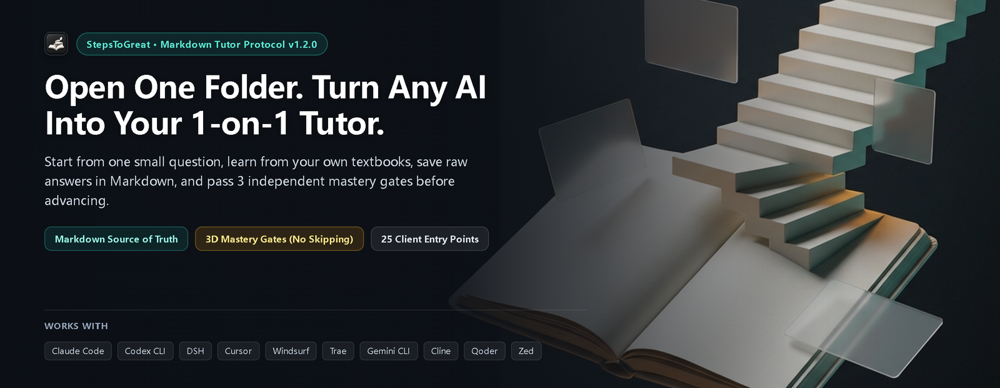
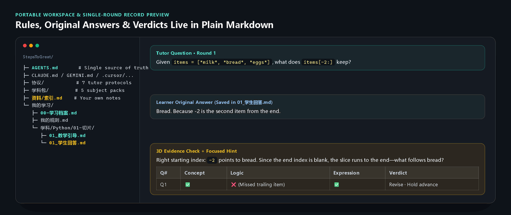
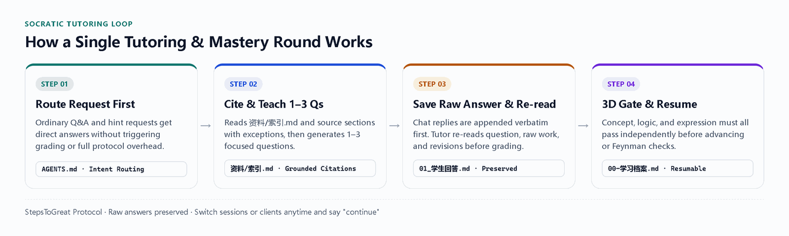
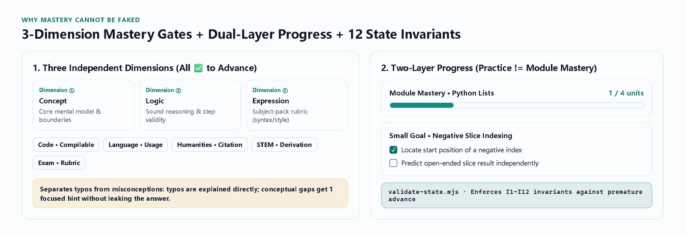
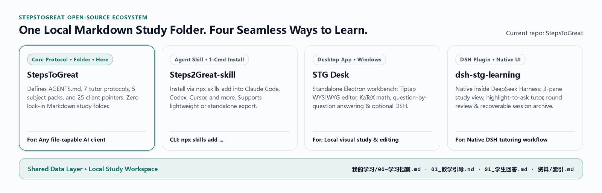

<div align="center">



<h1>StepsToGreat</h1>

<p><strong>A local-first Markdown protocol that turns any file-capable AI into a strict, resumable 1-on-1 mastery tutor.</strong></p>

<p>
  <a href="https://github.com/wildcat430524/StepsToGreat/actions/workflows/check.yml"></a>
  
  
  <a href="./LICENSE"></a>
  <a href="./LICENSE-DOCS"></a>
</p>

<p>
  <a href="#30-second-quick-start">Quick Start</a> ·
  <a href="#socratic-tutoring-loop">Tutoring Loop</a> ·
  <a href="#3-dimension-mastery-gates">Mastery Gates</a> ·
  <a href="#25-client-entry-points">Clients</a> ·
  <a href="#stepstogreat-ecosystem">Ecosystem</a> ·
  <a href="./docs/readme-details.en.md">Full Guide</a>
</p>

<p><a href="./README.md">简体中文</a> · <strong>English</strong></p>

</div>

---

## Why StepsToGreat?

Normal AI chats make learning feel effortless—until you try solving a problem on your own or return three days later to a blank context. StepsToGreat puts **every rule, original answer, feedback table, and study checkpoint** into plain local Markdown:

| Ordinary AI Chat | StepsToGreat Protocol |
| :--- | :--- |
| 🤖 Dumps the full solution before you think | **1–3 Questions per Round + Focused Hints**: fixes typos directly; gives one hint for conceptual gaps |
| 🎭 Praises "great job!" without checking rigor | **3 Independent Mastery Gates**: Concept, Logic, and Expression must all pass (✅) before advancing |
| 💨 Context vanishes when you switch tabs or tools | **Markdown Source of Truth**: switch between Codex, Claude, Cursor, or DSH and say `"continue"` |
| 📚 Hallucinates textbook sections on long docs | **Grounded Citations**: reads `资料/索引.md` & exact source sections (with exceptions) before teaching |

---

## 30-Second Quick Start

1. **Get the study folder**: [Download ZIP](https://github.com/wildcat430524/StepsToGreat/archive/refs/heads/main.zip) and extract it (or `git clone https://github.com/wildcat430524/StepsToGreat.git`).
2. **Open the whole folder** in any AI client with local file read/write access (Codex, Claude Code, DSH, Cursor, Windsurf, Trae, Gemini CLI, Cline, Qoder, etc.). [Client setup guide](./教程/02-agent-setup-guide.en.md)
3. **Tell the tutor what you want to learn today**:

```text
Please read AGENTS.md first. I know Python loops and get confused by negative indices.
I want to read list slices. I have 15 minutes today.
```

> Answer right in chat or edit the current round's `01_学生回答.md` directly. For formal practice, the tutor preserves your original answer verbatim, re-reads both question and work, and grades the whole round together.



---

## Socratic Tutoring Loop

Every message passes through a lightweight intent router in `AGENTS.md` (12 hard rules) so quick Q&A gets immediate answers without triggering heavy grading overhead:

<p align="center">
  <picture>
    <source media="(prefers-color-scheme: dark)" srcset="./docs/assets/tutoring-loop-en-dark.png">
    <source media="(prefers-color-scheme: light)" srcset="./docs/assets/tutoring-loop-en-light.png">
    
  </picture>
</p>

**Example exchange:**

> **Tutor**　There are three items in `["milk", "bread", "eggs"]`. What would `items[-2:]` keep?
>
> **Learner**　Bread. −2 is the second item from the end.
>
> **Tutor**　You found the starting point. `-2` points to bread. The blank after the colon tells the slice to go all the way to the end. What comes after bread?

- Explore further: [Full learning workflow](./docs/learning-workflow.en.md) · [Five-minute walkthrough](./示例/演示学科/README.md) · [State machine](./协议/04_状态机.en.md)

---

## 3-Dimension Mastery Gates

<p align="center">
  <picture>
    <source media="(prefers-color-scheme: dark)" srcset="./docs/assets/three-dimensions-en-dark.png">
    <source media="(prefers-color-scheme: light)" srcset="./docs/assets/three-dimensions-en-light.png">
    
  </picture>
</p>

### Two Separate Layers of Progress

Module progress counts units that have passed **final assessment**. The micro-goal checklist tracks skills verified by **actual answer evidence** in the current block:

**Python lists · 1 of 4 units mastered (illustration)**


- [x] Find the starting position of a negative index
- [ ] Independently predict the result of a slice with no end index

When you complete a goal, the tutor summarizes what you can now do and gives a clean stopping point. [Progress rules](./协议/06_小目标进度.en.md)

### 5 Built-in Subject Packs

| Subject Pack | Dimension ③ Check | Typical Topics | File |
| :--- | :--- | :--- | :--- |
| 💻 **Programming** | Compilable syntax & structure | Python, Java, JS, SQL, Algorithms | [`学科包/编程.en.md`](./学科包/编程.en.md) |
| 🗣️ **Language** | Grammar, tense, collocation & usage | English, Japanese, Foreign Languages | [`学科包/语言.en.md`](./学科包/语言.en.md) |
| 📖 **Humanities** | Argument structure, terms & citation | History, Philosophy, Law, Literature | [`学科包/文科.en.md`](./学科包/文科.en.md) |
| 🔬 **STEM** | Step derivations, symbols & units | Calculus, Physics, Chemistry, Biology | [`学科包/理科.en.md`](./学科包/理科.en.md) |
| 📝 **Exams** | Rubric format & scoring coverage | Standardized & certification exams | [`学科包/考试.en.md`](./学科包/考试.en.md) |

> Learning piano, fitness, writing, or a design tool? Copy [`_自定义学科包模板.md`](./学科包/_自定义学科包模板.md) to generate a custom rubric on the fly.

---

## Teach From Your Own Material

Place your lecture notes, Markdown chapters, or textbooks inside `资料/` and tell the tutor which section to study. It reads `资料/索引.md` and the exact section—including edge cases and exceptions—and cites the file and heading as it teaches. Run OCR on scanned PDFs first, or point the tutor to a verifiable primary source. [Materials guide](./资料/README.md) · [Retrieval & citation guide](./docs/material-retrieval.md)

---

## 25+ Client Entry Points

StepsToGreat keeps a single contract in [`AGENTS.md`](./AGENTS.md) and auto-generates **25 client pointers** (`CLAUDE.md`, `CODEBUDDY.md`, `GEMINI.md`, `.cursor/rules/`, `.trae/rules/`, `.windsurf/rules/`, `.agents/rules/`, etc.) via `_tools/setup-agents.mjs`.

<details>
<summary><strong>Supported AI clients and setup notes</strong></summary>

| Integration Type | Supported Tools | Notes |
| :--- | :--- | :--- |
| **Native `AGENTS.md`** | Codex CLI · DeepSeek Harness (DSH) · Cursor · Windsurf · Cline · Zed · Qoder · opencode | Zero config — open the root folder |
| **Generated Pointers** | Claude Code (`CLAUDE.md`) · CodeBuddy (`CODEBUDDY.md`) · Gemini CLI (`GEMINI.md`) · Antigravity (`.agents/rules/`) · Qwen Code (`QWEN.md`) · Aider (`CONVENTIONS.md`) | Redirects straight to `AGENTS.md` |
| **Opt-in Toggle** | Trae | Enable "Include AGENTS.md in context" in rule settings |

> Full matrix in [`docs/AGENT-COMPAT.md`](./docs/AGENT-COMPAT.md) and [`教程/01-five-minute-setup.en.md`](./教程/01-five-minute-setup.en.md).

</details>

---

## StepsToGreat Ecosystem

One portable Markdown study folder, four complementary ways to learn—switch anytime without migrating or losing your records:

<p align="center">
  <picture>
    <source media="(prefers-color-scheme: dark)" srcset="./docs/assets/ecosystem-en-dark.png">
    <source media="(prefers-color-scheme: light)" srcset="./docs/assets/ecosystem-en-light.png">
    
  </picture>
</p>

| Repository | Role | Best For |
| :--- | :--- | :--- |
| **StepsToGreat** (this repo) | Open protocol & portable folder | Opening a self-contained study folder in any AI tool |
| [Steps2Great-skill](https://github.com/wildcat430524/Steps2Great-skill) | Agent Skill (`npx skills add`) | One-command install into Claude Code, Codex, Cursor & clean workspaces |
| [STG-Desk](https://github.com/wildcat430524/STG-Desk) | Windows Electron workbench | WYSIWYG editing, KaTeX math, question-by-question answering & backups |
| [dsh-stg-learning](https://github.com/wildcat430524/dsh-stg-learning) | DeepSeek Harness plugin | Native 3-pane workspace with highlight-to-ask tutor inside DSH |

---

## FAQ

<details>
<summary><strong>How do I continue in another AI client?</strong></summary>

Open the same study folder in your new client and say `"continue"`. The tutor reads the handoff state in `我的学习/00-学习档案.md` and picks up seamlessly.

</details>

<details>
<summary><strong>How do I save personal study rules (e.g., "one question at a time")?</strong></summary>

Add your preferences to [`我的学习/我的规则.en.md`](./我的学习/我的规则.en.md). Follow [`docs/UPGRADE.md`](./docs/UPGRADE.md) when upgrading to preserve rules, profiles, and answers.

</details>

<details>
<summary><strong>Is it free?</strong></summary>

Yes—the protocol, templates, and tools are completely open source. Model usage is billed only by the AI client or provider you choose. [Full FAQ](./docs/readme-details.en.md#full-faq)

</details>

---

## Verification, Docs & Contributing

- **Automated Checks**: CI verifies pointer parity, state machine integrity (`validate-state.mjs` enforcing **these 12 invariants** across fixtures), material retrieval, behavior evals, routing contracts, and strict headless Mermaid rendering. Run `npm run verify` locally. [Evaluation method](./docs/behavior-evaluation.md) · [Simulations](./docs/simulations/) · [E2E report](./docs/E2E-RUN-REPORT.md)
- **Deep Dive**: [Expanded guide](./docs/readme-details.en.md) · [10 ADRs](./docs/adr/) · [Tutor protocol](./协议/00_导师协议.en.md) · [AGENTS.md](./AGENTS.md)
- **Contribute**: Try a round with your own textbook! If grading, citation, or resuming breaks, open an issue with a reproducible example—or submit a new subject pack or client pointer. If StepsToGreat helps you learn, consider leaving a ⭐ Star! [Contributing](./CONTRIBUTING.md) · [Report an issue](https://github.com/wildcat430524/StepsToGreat/issues)

---

## License

Code is licensed under [MIT](./LICENSE). Protocols, subject packs, tutorials, and templates are licensed under [CC BY 4.0](./LICENSE-DOCS). Keep attribution when redistributing teaching material.
