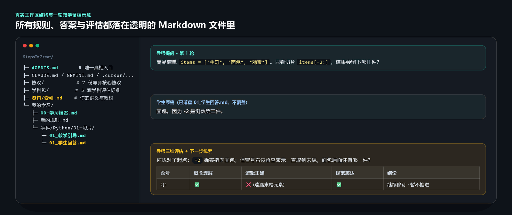
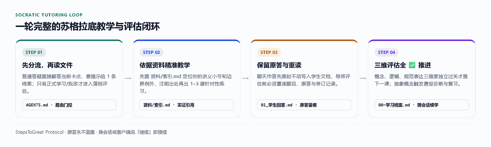
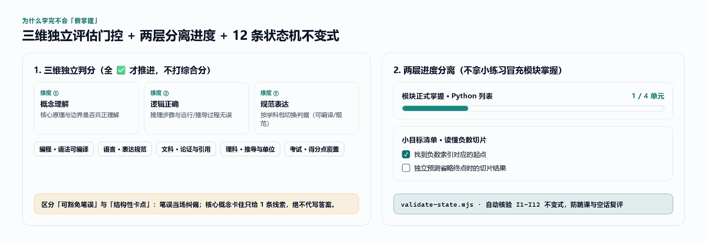
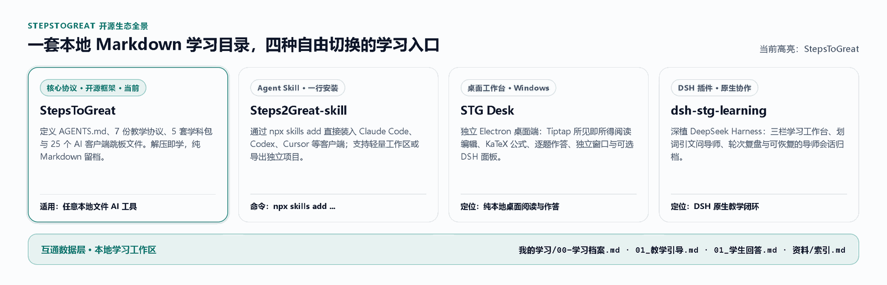

<div align="center">


<h1>StepsToGreat</h1>

<p><strong>把会读写文件的 AI 变成真正严师：按轮练习、保留原答、三维评估全通过才推进，换工具打开同一个文件夹就能接着学。</strong></p>

<p>
  <a href="https://github.com/wildcat430524/StepsToGreat/actions/workflows/check.yml"></a>
  
  
  <a href="./LICENSE"></a>
  <a href="./LICENSE-DOCS"></a>
</p>

<p>
  <a href="#30-秒快速开始">快速开始</a> ·
  <a href="#苏格拉底教学闭环">教学闭环</a> ·
  <a href="#三维评估与防跳课">三维评估</a> ·
  <a href="#兼容-25-客户端入口">客户端兼容</a> ·
  <a href="#stepstogreat-开源生态">生态全家桶</a> ·
  <a href="./docs/readme-details.md">完整文档</a>
</p>

<p><strong>简体中文</strong> · <a href="./README.en.md">English</a></p>

</div>

---

## 为什么选择 StepsToGreat？

普通 AI 聊天窗口学知识容易陷入「**一听就懂、换题就忘、换个窗口从头再来**」。StepsToGreat 用一套纯 Markdown 协议与状态机，把**教学主动权、做题记录和掌握判据**真正留在你本地的文件夹里：

| 常见 AI 聊天痛点 | StepsToGreat 的解法 |
| :--- | :--- |
| 🤖 问一句直接把答案贴完，自己没动脑 | **每轮 1–3 题 + 线索分级**：笔误直接纠偏解释，概念卡住只给 1 条针对性提示 |
| 🎭 客套夸「你理解得不错」，其实没真会 | **三维独立评估门控**：概念理解、逻辑正确、规范表达全 ✅ 才准推进，禁止打综合糊涂分 |
| 💨 聊完关掉网页就丢失上下文与原答 | **Markdown 唯一真相**：原答、修订、评估和交接状态全落盘，换工具说「继续」无缝接上 |
| 📚 教材越长 AI 越爱胡编页码和概念 | **实证检索引用**：先查 `资料/索引.md` 定位小节与例外再出题，注明来源文件与章节 |

---

## 30 秒快速开始

1. **获取学习文件夹**：[下载最新 ZIP](https://github.com/wildcat430524/StepsToGreat/archive/refs/heads/main.zip) 并解压（或 `git clone https://github.com/wildcat430524/StepsToGreat.git`）。
2. **用任意能读写本地文件的 AI 客户端打开整个目录**：支持 Codex、Claude Code、DSH、Cursor、Windsurf、Trae、Gemini CLI、Qoder、Cline 等。[查看接入指南](./教程/02-各工具接入指南.md)
3. **发一句你今天真想学的事**：

```text
请先读 AGENTS.md。我会 Python 循环，看到负数索引就容易混淆。
我想学会读列表切片，今天有 15 分钟。
```

> 可以在对话里直接回答，也可以把答案写进当前轮的 `01_学生回答.md`。正式作答时，导师会先原封不动保存你的原文、重读题目与答案，再给出整轮评估。



---

## 苏格拉底教学闭环

从日常答疑到正式闯关，所有请求先由 `AGENTS.md`（12 条硬规则）做轻量路由，避免普通提问误触发整套评估：

<p align="center">
  <picture>
    <source media="(prefers-color-scheme: dark)" srcset="./docs/assets/tutoring-loop-zh-dark.png">
    <source media="(prefers-color-scheme: light)" srcset="./docs/assets/tutoring-loop-zh-light.png">
    
  </picture>
</p>

**一轮真实对话示例：**

> **导师**　有三件商品 `["牛奶", "面包", "鸡蛋"]`。只看 `items[-2:]`，你觉得会留下哪几件？
>
> **学生**　面包。-2 是倒数第二件。
>
> **导师**　你找对了起点，`-2` 指向面包。冒号后面空着，表示从起点一直取到末尾。沿着清单往后走，面包之后还有哪一件？

- 想看完整多轮流转：[完整学习流程](./docs/learning-workflow.md) · [五分钟演示课](./示例/演示学科/README.md) · [状态机规范](./协议/04_状态机.md)

---

## 三维评估与防跳课

<p align="center">
  <picture>
    <source media="(prefers-color-scheme: dark)" srcset="./docs/assets/three-dimensions-zh-dark.png">
    <source media="(prefers-color-scheme: light)" srcset="./docs/assets/three-dimensions-zh-light.png">
    
  </picture>
</p>

### 两层进度分开展示

模块进度统计**通过最终复评的知识单元**，本次清单只记录**当前小目标里已有作答证据验证的技能**：

**Python 列表 · 已掌握 1/4 个单元（示意）**


- [x] 找到负数索引对应的起点
- [ ] 独立预测省略终点时的切片结果

小目标完成时，导师会总结你现在能独立做什么，并给出自然停点。[进度规则](./协议/06_小目标进度.md)

### 内置 5 套学科评估包

| 学科包 | 维度 ③ 专项判据 | 典型场景 | 入口 |
| :--- | :--- | :--- | :--- |
| 💻 **编程** | 语法可编译与结构正确 | Python / Java / JS / SQL / 算法 | [`学科包/编程.md`](./学科包/编程.md) |
| 🗣️ **语言** | 语法、时态、搭配与表达规范 | 英语、日语等外语表达 | [`学科包/语言.md`](./学科包/语言.md) |
| 📖 **文科** | 论证结构、术语与出处引用 | 历史、哲学、法学、文学 | [`学科包/文科.md`](./学科包/文科.md) |
| 🔬 **理科** | 推导严谨性、符号与单位 | 数学、物理、化学、生物 | [`学科包/理科.md`](./学科包/理科.md) |
| 📝 **考试** | 题型格式与核心得分点覆盖 | 考研、考公、专业资格认证 | [`学科包/考试.md`](./学科包/考试.md) |

> 学钢琴、健身、写作或特定软件操作？用 [`_自定义学科包模板.md`](./学科包/_自定义学科包模板.md) 现场生成一套评估口径。

---

## 用你自己的资料教

把讲义、Markdown 笔记或文本教材放进 `资料/`，告诉导师要学哪一节。导师会先定位 `资料/索引.md` 与对应章节中的前置条件和例外，再带着文件和小节出处来教。扫描版 PDF 建议先做 OCR；没有本地教材时，请提供可核对的一手来源。[资料说明](./资料/README.md) · [检索与引用方法](./docs/material-retrieval.md)

---

## 兼容 25+ 客户端入口

仓库只维护一份契约真相 [`AGENTS.md`](./AGENTS.md)，并由 `_tools/setup-agents.mjs` 自动生成 **25 个跳板文件**（`CLAUDE.md`、`CODEBUDDY.md`、`GEMINI.md`、`.cursor/rules/`、`.trae/rules/`、`.windsurf/rules/`、`.agents/rules/` 等），换工具学习无需复制规则。

<details>
<summary><strong>点击查看主流客户端接入方式与注意事项</strong></summary>

| 客户端类型 | 代表工具 | 接入方式 |
| :--- | :--- | :--- |
| **原生支持 AGENTS.md** | Codex CLI · DeepSeek Harness (DSH) · Cursor · Windsurf · Cline · Zed · Qoder · opencode | 直接打开根目录即可识别 |
| **自动跳板覆盖** | Claude Code (`CLAUDE.md`) · CodeBuddy / WorkBuddy (`CODEBUDDY.md`) · Gemini CLI (`GEMINI.md`) · Antigravity (`.agents/rules/`) · Qwen Code (`QWEN.md`) · Aider (`CONVENTIONS.md`) | 仓库已生成对应跳板，自动引向 `AGENTS.md` |
| **需手动开启开关** | Trae | 在设置中打开「将 AGENTS.md 包含在上下文中」 |

> 完整兼容表与校验方法见 [`docs/AGENT-COMPAT.md`](./docs/AGENT-COMPAT.md) 与 [`教程/01-五分钟上手.md`](./教程/01-五分钟上手.md)。

</details>

---

## StepsToGreat 开源生态

一套纯本地 Markdown 目录，四种自由搭配的学习体验——你的所有学习档案、原答和教材在四者之间完全互通：

<p align="center">
  <picture>
    <source media="(prefers-color-scheme: dark)" srcset="./docs/assets/ecosystem-zh-dark.png">
    <source media="(prefers-color-scheme: light)" srcset="./docs/assets/ecosystem-zh-light.png">
    
  </picture>
</p>

| 项目 | 定位 | 适合这样的你 |
| :--- | :--- | :--- |
| **StepsToGreat**（本仓库） | 开放教学协议与便携文件夹 | 想拿一个纯 Markdown 目录在任何 AI 工具里自学 |
| [Steps2Great-skill](https://github.com/wildcat430524/Steps2Great-skill) | 标准 Agent Skill (`npx skills add`) | 想一行命令装进 Claude Code / Codex / Cursor 并保留干净工作区 |
| [STG-Desk](https://github.com/wildcat430524/STG-Desk) | Windows 独立桌面工作台 | 喜欢所见即所得排版、公式渲染、逐题专注作答与历史版本备份 |
| [dsh-stg-learning](https://github.com/wildcat430524/dsh-stg-learning) | DeepSeek Harness 原生插件 | 想直接在 DSH 内实现左侧目录、中间阅读作答、右侧导师划词问答 |

---

## 常见问题

<details>
<summary><strong>换客户端或跨天回来时怎样接着学？</strong></summary>

用新客户端打开同一个学习目录，直接发「继续」。导师会读取 `我的学习/00-学习档案.md` 顶部的交接状态与停点，接着上一次进度继续。

</details>

<details>
<summary><strong>怎样固定自己的学习偏好（如「每次只出一道题」）？</strong></summary>

把个人偏好写进 [`我的学习/我的规则.md`](./我的学习/我的规则.md)。升级框架时按 [`docs/UPGRADE.md`](./docs/UPGRADE.md) 操作可完整保留规则、档案与原答。

</details>

<details>
<summary><strong>项目收费吗？</strong></summary>

协议、模板和配套工具完全开源免费；模型调用费用取决于你所选 AI 客户端与模型服务商的计费规则。[更多问题全文](./docs/readme-details.md#常见问题全文)

</details>

---

## 验证、文档与贡献

- **自动化校验**：CI 覆盖跳板一致性、`validate-state.mjs`（12 条不变式 + 夹具回归）、资料检索、行为评测、路由预算与严格模式 Mermaid 渲染校验。本地运行 `npm run verify`。[行为评测方法](./docs/behavior-evaluation.md) · [仿真案例](./docs/simulations/) · [端到端报告](./docs/E2E-RUN-REPORT.md)
- **设计深入阅读**：[完整说明](./docs/readme-details.md) · [10 篇架构决策记录](./docs/adr/) · [导师核心协议](./协议/00_导师协议.md) · [AGENTS.md](./AGENTS.md)
- **欢迎贡献**：用自己的教材跑一轮，遇到漏判、引用失真或无法续学，欢迎提 Issue 附上可复现例子；也欢迎贡献新学科包或新 AI 工具跳板！觉得有帮助的话，请点一颗 ⭐ Star 支持。[贡献指南](./CONTRIBUTING.md) · [反馈问题](https://github.com/wildcat430524/StepsToGreat/issues)

---

## 许可证

代码采用 [MIT](./LICENSE)，教学协议、学科包、教程与模板采用 [CC BY 4.0](./LICENSE-DOCS)。转载教学文档请保留署名与出处。
