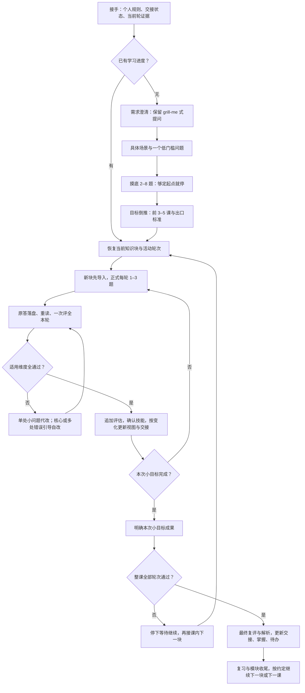

# StepsToGreat 完整学习流程

> 本文串联现有流程，不新增一份规则或学习状态。详细口径仍以 [导师协议](../协议/00_导师协议.md) 为准。
> English: [Learning workflow](./learning-workflow.en.md)

## 从开始到掌握

图中的分支不省略推进门槛：恢复未通过轮次时先修订；新知识块须先导入；必要的费曼或综合收尾也属于预先约定的完成条件。暂停时先保存已有证据，不强行走完图。

## 各阶段做什么，留下什么

| 阶段 | 关键动作与门槛 | 记录位置 |
|---|---|---|
| 接手与分流 | 工程请求按工程处理；教学先读个人规则，再读 🚦 和当前教学总入口、分轮教学、回答。4 行以内说明现状。已有进度不重做首次流程 | 🚦 指向当前证据；不从旧聊天推断 |
| **需求澄清：grill-me** | 先查文件里的事实，收齐学什么、为什么、基础、期限、真实投入时间；对模糊目标与取舍追问、给建议、复述理解供纠偏。独立缺项一次问，依赖项等前提明确再问；需求明确即停止 | 初期可只在聊天确认；保存或转正式时写 📋，排课取舍写课程路线 |
| 场景导入 | 每块新内容用具体处境、要办的事、小障碍和**当前一个问题**起步；先针对原答反馈，再讲解。不用功能菜单替代故事，不预发后续问题 | 初步观察，记录原题、原答和提示；不标掌握。需要保存时按导入协议落档 |
| 首次摸底 | 选学科包，按基础→应用→进阶自适应探测；总计 **2–8 题，每轮 1–3 题**，够定起点就停。可复用有记录、有诊断价值的导入题；未测范围、提示如实记录 | 学科目录的 `00-摸底测试.md`；📋 + 🚦 |
| 排路线 | 从目标倒推前 **3–5 课**，声明前置、模块边界、每课出口标准与必要收尾；不按教材目录机械排课。目标待定时用双方认可的暂定探索方向 | 学科目录的 `00-课程路线.md`；不在路线重复维护当前轮状态 |
| 正式发课 | 每轮 1–3 题，默认 2 题，新概念或重题型减量；一课通常 2–3 轮。导入已覆盖同一块就沿用，不重复故事 | `01_教学引导.md` 作总入口；每轮新建 `第N轮_教学引导.md` 保存完整讲解、例子与题面；`01_学生回答.md` 累计作答。发课更新 🚦 + 📚 |
| 作答与评估 | 学生说“完成了/改好了”就重读当前轮原答与修订；聊天提交先原文追加再重读。本轮全部题目一次评全，概念、逻辑、学科规范独立评分，适用维度全 ✅ 才通过 | 回答文档追加逐题评估；不重复抄已有原答，不覆盖历史 |
| 纠错与复评 | 整题仅一处局部小问题可代改并讲“原答案→原因→改法”；核心概念、逻辑或多处独立结构错误由学生修订。同根因可合并解释，各维仍如实评分。复评只评修订题，通过题沿用原判且在全题表注明 | 修订追加原答后；每次提交追加对应评估。未通过不进入下一轮 |
| 小目标完成 | 所有技能有证据且本块正式轮次通过，明确“你现在能……”并停下；同课下一块也等“继续”，已有连续学习约定除外 | 同步教学总入口与回答文档顶部；必要时只改 🚦，不提前改 📊 |
| 整课收尾 | 回看全部轮次证据，写覆盖全部题目的最终复评表和必要解析；全部适用维度通过才标整课掌握。下一课未发布就用有说明的占位，不编路径 | 回答文档的“最终复评结果”“正确答案与解析”；更新 🚦 / 📊 / ⏳，保持 📚 索引准确 |
| 长期巩固 | 每掌握 3 个新知识点后安排 1 个综合复习问题；新知识关联旧知识。大模块收尾做费曼诊断，纯操作不做；一课最多一次、不连续两轮，费曼轮只出该题、只评概念。拒绝费曼可换普通题 | 原答与评估仍在所属回答文档；挂起复习/重讲记 ⏳，不建立另一份状态表 |

## grill-me 放在哪

开始阶段的需求确认，以及学生主动要求“把这个决定想清楚”时的可选质询，都保留了这套提问思路。原有说明见 [需求确认与质询](./readme-details.md#需求确认与质询)；本次将名称和接续补进入口与 [对话导入第 1 节](../协议/05_对话导入.md#1-什么时候用)。这表示方法已融入项目，**不要求额外安装或自动调用外部 skill**。

三种提问各有用途：**需求质询决定学什么和怎么取舍；摸底定位实际起点；教学与费曼验证是否真会。** 需求回答不能当掌握证据。独立的决策质询按用户请求采用，不让“必须问到毫无未决项”阻止目标明确的学生开始学习；已有授权也不重复索要许可。

## 全程都要守住的部分

- **来源**：先读/建 `资料/索引.md`，定位后完整读小节与例外，引用文件、节、页码或行号；没有学生资料时用可核实的一手来源。不可读就停下说明缺口，搜索摘要不算依据，原始资料只增不改。
- **两层进度**：模块 `K/T` 来自路线定义的知识单元与整课最终复评；本次清单是 2–4 个具体技能，极小目标可 1 项。导入只作初步观察，提示后完成不能勾独立技能；清单全钩不等于模块满格。
- **按变化更新**：对话、教学总入口、回答顶部保持一致；只替换展示快照。K/T 没变复用图；普通复评不为重画视图重读全课、路线和状态机。编程题默认静态核对、纸面推演，实际运行须学生要求；框架开发按工程要求验证。
- **卡住与暂停**：先换角度，再换教法类别，连续三次未讲通则给答案与解释并检查复述；导师代答后的复述不能充当独立掌握，后续仍须验证。未通记录重讲、换时间处理；暂停时落档，不发新题。
- **个性化与切换**：长期偏好经授权写进个人规则并记变更；教学不改框架。多学科交替时只有一个当前学科、一个活动轮次，切换前先收尾，其他进度放 📚 状态列，课号带学科前缀。跳课先局部重测。
- **skill 版交付**：手写 `SKILL.md` 单独维护，协议等由上游同步；独立学习项目携带本地框架，轻量工作区依赖安装的 skill。升级保护个人规则、档案、原答与资料，不把开发者学习数据打包发布。格式、状态和回归检查不证明真人学习收益。

按事件查详细口径：[摸底](../协议/01_摸底剧本.md) · [新课](../协议/02_新课模板.md) · [落档](../协议/03_落档事件表.md) · [状态校验](../协议/04_状态机.md) · [导入](../协议/05_对话导入.md) · [进度](../协议/06_小目标进度.md) · [学科包](../学科包/README.md)。
